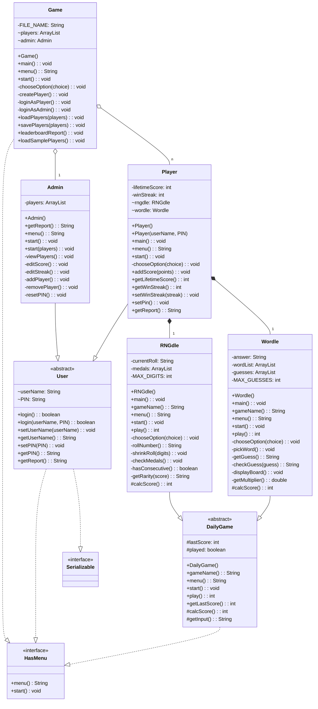

# Final Project Proposal
Daily Games
Proposal
Antonio Brunt, CS121

# Elevator Pitch
This project is made to create opportunities for users to participate in text-based randomization games. 
These will specifically employ use of several Object-Oriented programming techniques, and encourage persistent 
daily usage. This project demonstrates concepts learned in CS120 & CS121;
such as abstraction, aggregation, inheritance, serialization, and data structures.

## Purpose
The Daily Games offer users a program to come back to and stay invested in. The ultimate goal is not the game itself,
but rather to capture the attention of the user and maintain it. 
The goal of this project is to win an audience, and provide a uniquely fun experience without the need for complexity. 

## Overview
The Daily Games will consist of Worldle-Lite and RNGdle.

RNGdle - a game in which the user rolls for 1-6 digit number, and based on their RNG, receive point-based rewards through custom medals
The medals are based on unique conditions a roll can meet (e.g consecutive numbers, 4 or less digits, certain numbers being present).
Point rewards scale based on the "rarity" of the medals, and if a point total exceeds certain margins the roll is deemed a certain rarity (e.g rare, epic, legendary)

Wordle-Lite - a spinoff of Wordle with a limited range of words; given a 5 character limit per guess, the user must continue guessing until
there is an exact match with the computer chosen word. The player is rewarded with points upon successful completion. 
each guess will have a letter highlighted if it is used within the correct word, and be super highlighted if it is in the correct position.
Points scale based on # of guesses it took to complete the game.

## Classes
- RNGdle: Public class implementing Menu and Serialization
- Wordle: Clone of RNGdle with different functionality.
- Admin: Manual editor for player information and login info
- User: Login functionality, Accounts
- Game: Handles users and admins on file, loading and saving, main menu

## Implementation of Programming Concepts
- Inheritance: All classes inherit from HasMenu interface
- Abstraction: Several classes are abstract, to hide unnecessary implementation details and get player information
- Serialization: Used for saving, editing, and maintaining user information (logins, point totals, streaks) 
- IO: Reading and writing to an input and output stream will be used in the project

Login Screen Interface
```
- Create new User (username/pin)
- Admin Login (user who can manually edit other users' score)
- Exit (saves data locally, exit program)
```
Menu Interface
```
- Load Username ("Welcome, " + userName) 
- Lifetime Score (stored locally in csv and displayed on menu per user)
- Provide options to log out (return to login screen), play rngdle/wordle lite
- Log Out Selected: Return to login screen
```
RNGdle
```
- Roll randomized number (7 digits base, can be shrunk as low as 1 digit)
- Score based on roll quality
- Score Modifiers (e.g final roll includes a consecutive sequence, add +500 score)
- Calculate final score and add to lifetime score for users in a csv file stored locally
```
Wordle Lite
```
- Roll random (1-100) 5 letter words as chosen by computer
- Give user a max of 5 guesses to get the word correct
- Point multiplier based on # of guesses to get the word
- Calculate final score and add to lifetime score for users in local file
- Maintain a "winstreak" value and update the player information
```

### Milestones
- UML
- Flowchart Diagram
- Algorithm
- Save and Load Consumers
- Login Handling
- RNGdle Game
- Wordle Game
- Admin


# UML


